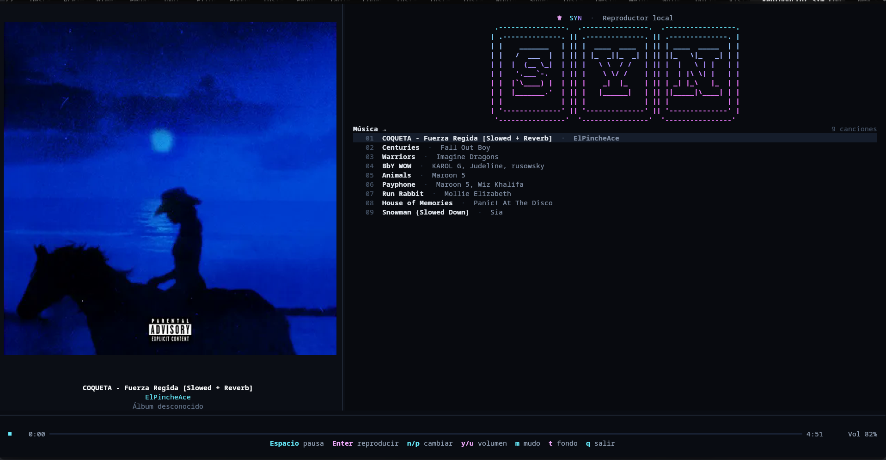

# SYN 🎵

<p align="center">
  
</p>

<p align="center">
  
  
  
  
</p>

Reproductor de música local ultraligero y elegante para la terminal, construido con **Textual** y diseñado para **Kitty**. 

- 🖼️ **Protocolo Gráfico Nativo (TGP):** Carátulas en alta resolución directamente en tu terminal.
- 🎵 **Soporte Universal:** MP3, FLAC, WAV y OGG con extracción de metadatos mediante **Mutagen**.
- ⚡ **Alto Rendimiento:** Consumo mínimo de CPU y RAM, con repintado inteligente bajo demanda.
- 🎨 **Modo Transparente:** Integración perfecta con fondos translúcidos y difuminados de Kitty.

---

## 🚀 Instalación Rápida

### 1. Arch Linux / CachyOS / Manjaro
```bash
git clone https://github.com/h73212653-code/syn.git ~/syn
cd ~/syn
./install-cachyos.sh
```

### 2. Fedora / Nobara / Debian / Ubuntu (Universal)
```bash
git clone https://github.com/h73212653-code/syn.git ~/syn
cd ~/syn
./install.sh
```

---

## 📋 Guía Detallada de Instalación por Distro

### Instalación en Fedora / Nobara
Requisitos del sistema:
```bash
sudo dnf install kitty python3 python3-pip pipewire pipewire-pulseaudio git @development-tools
```

### Instalación en CachyOS / Arch Linux
CachyOS usa `pacman`:
```bash
sudo pacman -S --needed --noconfirm kitty python python-pip pipewire pipewire-pulse git libpulse base-devel
```

---

## 🕹️ Arrancar

El instalador crea el comando global `syn`. Escríbelo en cualquier terminal:

```bash
syn
```

Para abrir SYN en una ventana dedicada de Kitty con soporte gráfico completo:
```bash
syn-kitty
```

También puedes ejecutarlo sin instalarlo:
```bash
./bin/syn
./bin/syn-kitty
```

---

## 📊 Consumo

Medido en Fedora/CachyOS con Kitty, después del arranque:

| Estado | CPU | RAM |
| --- | ---: | ---: |
| Abierto en reposo | ~0.07% | ~81 MB |
| Reproduciendo MP3 (80×24) | ~1.4% | ~98 MB |
| Reproduciendo en ventana grande | ~2–4% | ~98 MB |
| En pausa | ~0.7% | ~98 MB |
| Cerrado | 0% | 0 MB |

---

## 🎵 Música

La carpeta configurada por defecto es:
```toml
music_dir = "~/Musica"
recursive = true
```

Se puede cambiar de varias formas:
```bash
syn --music-dir ~/Música --no-recursive
SYN_MUSIC_DIR=~/Música syn
```

La búsqueda acepta **MP3, FLAC, WAV y OGG**. Las carátulas se extraen de las etiquetas del archivo (ID3/APIC, FLAC PICTURE, OGG METADATA_BLOCK_PICTURE).

---

## ⌨️ Controles

| Tecla | Acción |
| :--- | :--- |
| `↑` / `↓` o `k` / `j` | Navegar por la lista |
| `Enter` | Reproducir la pista seleccionada |
| `Espacio` | Pausar / reanudar |
| `n` / `p` | Siguiente / anterior |
| `y` / `u` | Subir / bajar el volumen (5%) |
| `m` | Silenciar / restaurar sonido |
| `t` | Activar / desactivar fondo transparente |
| `q` | Salir |

---

## 📂 Estructura

```
syn/
├── assets/
│   └── SYN.png             # Captura de pantalla oficial
├── bin/
│   ├── syn                 # Lanzador en terminal actual
│   └── syn-kitty           # Abre ventana nueva de Kitty
├── syn/
│   ├── __init__.py
│   ├── __main__.py         # Punto de entrada
│   ├── app.py              # App, layout, atajos y estado
│   ├── artwork.py          # Carátulas + generación de portadas
│   ├── config.py           # TOML, entorno y CLI
│   ├── library.py          # Escaneo y metadatos con mutagen
│   ├── player.py           # Reproducción con pygame-ce
│   ├── widgets.py          # Portada, lista y logo ASCII
│   └── styles.tcss         # Estilos de Textual
├── config.toml
├── install.sh
├── install-cachyos.sh      # Instalador para CachyOS (pacman)
├── pyproject.toml
├── requirements.txt
└── README.md
```

---

## 🛠️ Problemas frecuentes

- **No hay sonido:** comprueba que PipeWire/PulseAudio esté activo con `pactl info`.
- **La portada sale con caracteres de bloque:** estás fuera de Kitty o el protocolo gráfico no está disponible. Abre con `syn-kitty`.
- **No aparecen canciones:** revisa `music_dir` en `config.toml`, los permisos y que sean `.mp3`, `.flac`, `.wav` u `.ogg`.
- **Fuente rara en el logo:** SYN solo usa caracteres Unicode de bloque; no necesita una Nerd Font.
